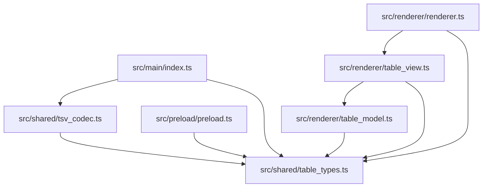
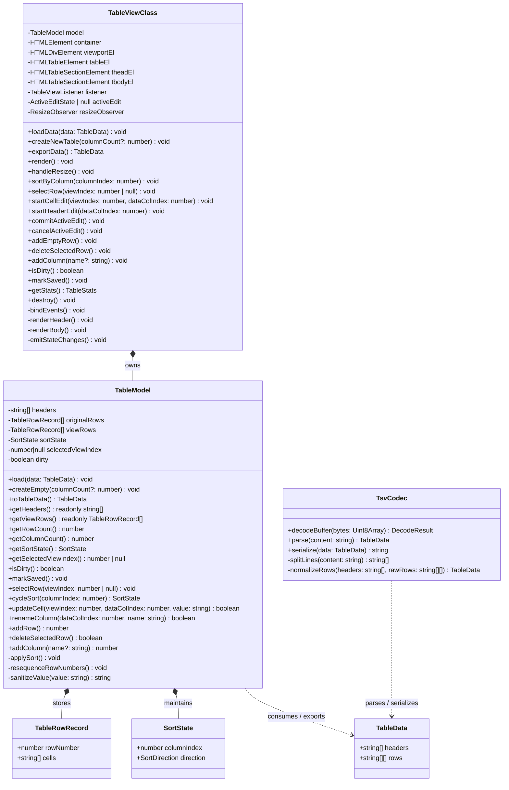
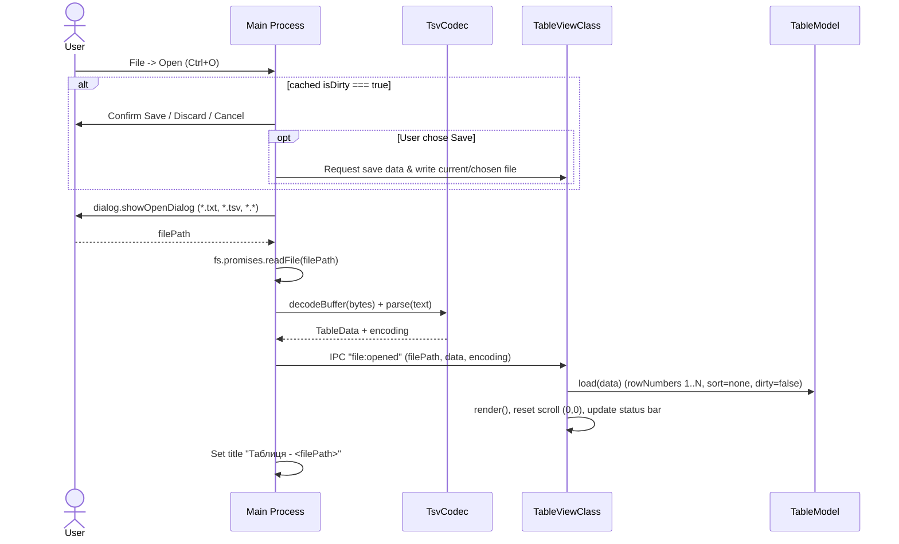
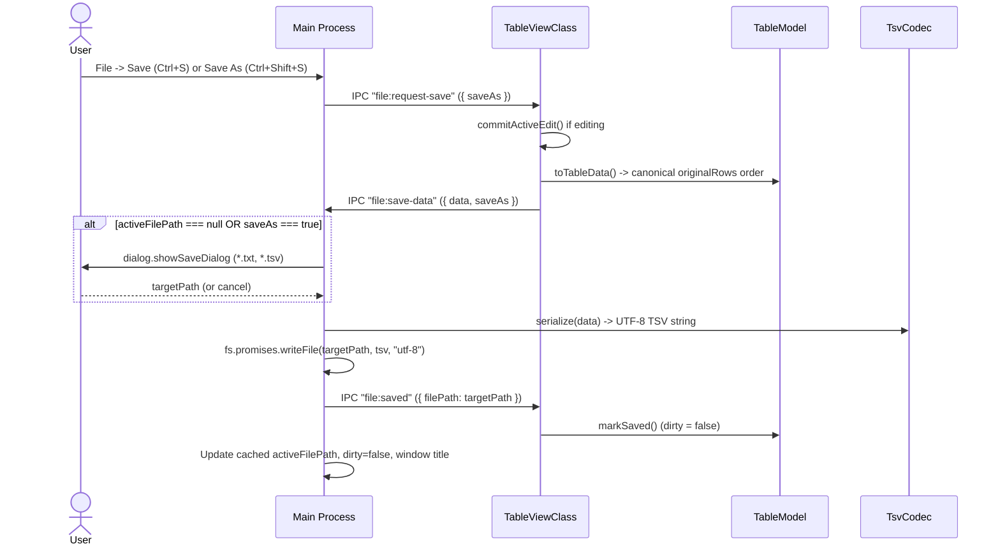

# Architecture Design: Table Viewer & Editor (`calc_work_oop`)

> **Status:** Approved baseline from architecture review  
> **Related Spec:** [spec.md](file:///home/prisyaga/uni/oop/calc_work_oop/spec.md)  
> **Reference Style:** `../graphical-editor` (adapted from `bun` to `npm` + `esbuild`)

---

## 1. Architectural Principles

1. **Minimalist & Crisp OOP Design:** Keep every module lean, single-purpose, and readable without unnecessary abstractions (no virtual-scroll machinery, no Undo/Redo stack, no column-deletion complexity).
2. **Process Isolation (Electron Security):** `contextIsolation: true`, `nodeIntegration: false`. Only the Main process touches Node `fs` and native OS dialogs; Renderer interacts exclusively through a typed `window.electronAPI` bridge in `preload.ts`.
3. **3-Class Table Decomposition (Option 1):**
   - `TsvCodec` — pure Delimited ASCII (`\t`) format codec (parsing, serialization, UTF-8 / `windows-1251` decoding).
   - `TableModel` — pure in-memory data model, persistent 1-based row numbers, 3-state sorting, edit mutations, and `isDirty` tracking.
   - `TableViewClass` — dedicated `TableView` UI controller owning `TableModel`, DOM rendering (`DocumentFragment`), 2D scrolling, window resize adaptation, and inline editing.
4. **Academic Alignment:** Source code inside `src/` maps directly to the required `#include`/import hierarchy diagram and UML class diagram in the OOP RGR report. Local verification tests live strictly in `tests/` for developer use and are **excluded from and unmentioned in the academic report**.

---

## 2. Project Layout & Build Pipeline

### 2.1 Directory Tree

```text
calc_work_oop/
├── package.json                  # npm scripts & dependencies (electron, typescript, esbuild, oxlint, prettier)
├── tsconfig.json                 # Strict TypeScript checking (noEmit: true)
├── .oxlintrc.json                # Linter rules (aligned with graphical-editor)
├── .prettierrc                   # Code formatting rules
├── index.html                    # Main window markup (toolbar, table container, status bar)
├── src/
│   ├── shared/
│   │   ├── table_types.ts        # Shared interfaces: TableData, SortState, ElectronAPI, IPC types
│   │   └── tsv_codec.ts          # TsvCodec class (TSV parse/serialize + UTF-8/cp1251 buffer decode)
│   ├── main/
│   │   └── index.ts              # Electron Main process: window, native menu, file dialogs, fs I/O
│   ├── preload/
│   │   └── preload.ts            # contextBridge exposing typed window.electronAPI
│   └── renderer/
│       ├── renderer.ts           # Renderer bootstrap (app entry point, equivalent to main.cpp)
│       ├── table_view.ts         # TableViewClass (dedicated TableView module)
│       ├── table_model.ts        # TableModel class (rows, 3-state sort, mutations, isDirty)
│       └── styles/
│           ├── normalize.css
│           └── index.css         # Flex layout, 2D scroll viewport, sticky headers & row numbers
├── dist/                         # Compiled build output (gitignored)
│   ├── main.js
│   ├── preload.js
│   └── renderer.js
└── tests/                        # Local-only Node unit tests (NOT included in report)
    ├── tsv_codec.test.ts
    └── table_model.test.ts
```

### 2.2 Build & Run Pipeline (`npm` + `esbuild` + `tsc`)

| Script                | Command                                                                                                              | Purpose                                                              |
| --------------------- | -------------------------------------------------------------------------------------------------------------------- | -------------------------------------------------------------------- |
| `typecheck`           | `tsc --noEmit`                                                                                                       | Strict static type verification across all TS targets                |
| `build:main`          | `esbuild src/main/index.ts --bundle --platform=node --format=esm --external:electron --outfile=dist/main.js`         | Bundles Main process + shared `TsvCodec`                             |
| `build:preload`       | `esbuild src/preload/preload.ts --bundle --platform=node --format=cjs --external:electron --outfile=dist/preload.js` | Bundles Preload as CommonJS (required by sandboxed Electron preload) |
| `build:renderer`      | `esbuild src/renderer/renderer.ts --bundle --platform=browser --format=esm --outfile=dist/renderer.js`               | Bundles Renderer + `TableViewClass` + `TableModel`                   |
| `build`               | `npm run build:main && npm run build:preload && npm run build:renderer`                                              | Builds all runtime artifacts into `dist/`                            |
| `start`               | `npm run build && electron dist/main.js`                                                                             | Builds and launches the Electron desktop app                         |
| `lint` / `format`     | `oxlint` / `prettier --write .`                                                                                      | Code quality & style checks                                          |
| `test` _(local only)_ | `node --experimental-strip-types --test tests/*.test.ts`                                                             | Local unit tests on Node v22+ (no extra test framework needed)       |

---

## 3. Process Boundaries & IPC Contract

### 3.1 Process Responsibilities

```mermaid
flowchart LR
    subgraph Main["Main Process (src/main/index.ts)"]
        M_MENU["Native Menu (Файл, Таблиця, Довідка)"]
        M_DLG["OS Dialogs (Open / Save / Confirm)"]
        M_FS["fs.promises + TsvCodec"]
        M_STATE["Cached activeFilePath & isDirty"]
    end

    subgraph Preload["Preload (src/preload/preload.ts)"]
        API["contextBridge: window.electronAPI"]
    end

    subgraph Renderer["Renderer Process (src/renderer/)"]
        R_APP["renderer.ts (Bootstrap & Toolbar/Status)"]
        R_TV["TableViewClass (UI & Events)"]
        R_TM["TableModel (Data, Sort, Dirty)"]
    end

    Main <-->|"IPC Channels"| Preload
    Preload <-->|"window.electronAPI"| Renderer
```



- **Main Process owns:** `activeFilePath: string | null`, cached `isDirty: boolean` (synchronized from Renderer), window title formatting, native dialogs (`showOpenDialog`, `showSaveDialog`, `showMessageBox`), and reading/writing disk files via `fs.promises` + `TsvCodec`.
- **Renderer Process owns:** authoritative `TableModel` state (headers, `originalRows`, `viewRows`, active sort, `isDirty`) and all DOM interaction inside `TableViewClass`.

### 3.2 IPC Channels & Typed Bridge (`ElectronAPI`)

| Direction                   | Channel               | Payload                                                                      | Purpose                                                              |
| --------------------------- | --------------------- | ---------------------------------------------------------------------------- | -------------------------------------------------------------------- |
| Main $\rightarrow$ Renderer | `file:opened`         | `{ filePath: string; data: TableData; encoding: 'utf-8' \| 'windows-1251' }` | Loads parsed TSV file into `TableViewClass`                          |
| Main $\rightarrow$ Renderer | `menu:new-table`      | `void`                                                                       | Creates a fresh default empty table                                  |
| Main $\rightarrow$ Renderer | `menu:add-row`        | `void`                                                                       | Triggers `tableView.addEmptyRow()`                                   |
| Main $\rightarrow$ Renderer | `menu:delete-row`     | `void`                                                                       | Triggers `tableView.deleteSelectedRow()`                             |
| Main $\rightarrow$ Renderer | `menu:add-column`     | `void`                                                                       | Triggers `tableView.addColumn()`                                     |
| Main $\rightarrow$ Renderer | `file:request-save`   | `{ saveAs: boolean; closeAfterSave?: boolean }`                              | Requests current `TableData` for disk persistence                    |
| Main $\rightarrow$ Renderer | `file:saved`          | `{ filePath: string }`                                                       | Notifies Renderer to clear `isDirty` (`markSaved()`)                 |
| Renderer $\rightarrow$ Main | `file:save-data`      | `{ data: TableData; saveAs: boolean; closeAfterSave?: boolean }`             | Sends canonical `TableData` (`originalRows`) to Main to write TSV    |
| Renderer $\rightarrow$ Main | `table:dirty-changed` | `isDirty: boolean`                                                           | Syncs dirty state to Main for window title `*` and close/open guards |
| Renderer $\rightarrow$ Main | `app:action`          | `'new' \| 'open' \| 'save'`                                                  | Allows toolbar buttons in Renderer to invoke Main file workflows     |

_(Note: Using `ipcRenderer.send` / `ipcRenderer.on` with typed wrappers in `preload.ts` directly mirrors `../graphical-editor` while keeping the surface area small and explicit.)_

---

## 4. OOP Module Hierarchy & Class Design

### 4.1 Module Import Hierarchy (C++ `#include` Equivalent)



### 4.2 Class Diagram



### 4.3 Academic Rationale (Task 3 Requirement #5)

Task 3 requires encapsulating table behavior in `TableViewClass` inside its own `TableView` module, and permits splitting the module interface across multiple classes when justified:

1. **`TsvCodec` (Format Layer):** Isolates Delimited ASCII (`\t`) parsing, encoding detection, and serialization from both UI and domain logic. Because it has zero browser dependencies, the Electron Main process can parse and serialize files directly at the I/O boundary.
2. **`TableModel` (Domain Layer):** Isolates in-memory table representation, 1-based row numbering, 3-state alphabetical/numeric sorting, editing mutations, and `isDirty` tracking from DOM manipulation.
3. **`TableViewClass` (Presentation & Interaction Layer):** Owns `TableModel` via composition and exposes the complete display + editing API (`render()`, `handleResize()`, `sortByColumn()`, `startCellEdit()`, `addEmptyRow()`, `deleteSelectedRow()`, `addColumn()`), handling DOM rendering, 2D scrolling, and user input.

---

## 5. Data Structures, Sorting & TSV Semantics

### 5.1 Shared Types (`src/shared/table_types.ts`)

```typescript
export type SortDirection = 'none' | 'asc' | 'desc';

export interface SortState {
  /** 0 = leftmost row-number column; 1..N = data columns; -1 = unsorted */
  columnIndex: number;
  direction: SortDirection;
}

export interface TableData {
  headers: string[];
  rows: string[][];
}

export interface TableRowRecord {
  /** Persistent 1-based row ID tied to originalRows order */
  rowNumber: number;
  cells: string[];
}

export interface TableStats {
  rowCount: number;
  columnCount: number;
  sortState: SortState;
  selectedRowNumber: number | null;
  isDirty: boolean;
}
```

### 5.2 `TsvCodec` Rules (`src/shared/tsv_codec.ts`)

1. **Decoding (`decodeBuffer(bytes: Uint8Array)`):**
   - Attempts strict UTF-8 decoding first (`new TextDecoder('utf-8', { fatal: true }).decode(bytes)`).
   - If strict UTF-8 throws (common for legacy Ukrainian Windows `.txt` files), falls back to `new TextDecoder('windows-1251').decode(bytes)` and reports `encoding: 'windows-1251'`.
   - Strips leading UTF-8 BOM (`\uFEFF`) if present.
2. **Parsing (`parse(content: string)`):**
   - Splits on `/\r?\n/`. Removes a single trailing empty line caused by a final newline (`\n` at EOF) while preserving interior empty lines/cells.
   - Throws a descriptive error if the file has no non-empty header line.
   - Line `0` split on `'\t'` $\rightarrow$ `headers`.
   - Lines `1..K` split on `'\t'` $\rightarrow$ `rawRows`.
   - Normalizes row widths: if a row has fewer cells than `headers.length`, missing cells are padded with `""`; if a row has more cells than `headers.length`, `headers` expands with generated column names (`Стовпчик N`) so no data is silently lost.
3. **Serialization (`serialize(data: TableData)`):**
   - Sanitizes any stray `\t`, `\r`, `\n` inside cell/header values (replaces with `' '`) so TSV structure stays valid.
   - Joins `headers` with `'\t'`, then each row with `'\t'`, joined by `'\n'` with a trailing `'\n'`, written as BOM-free UTF-8.

### 5.3 3-State Sorting Semantics (`TableModel`)

- **Trigger:** Right-click (`contextmenu` event with `e.preventDefault()`) on any `<th>` header cell.
- **State Machine (`cycleSort(columnIndex)`):**
  - Clicking a **new** column (`columnIndex !== sortState.columnIndex`) $\rightarrow$ `{ columnIndex, direction: 'asc' }`.
  - Clicking the **active** column cycles: `'asc'` $\rightarrow$ `'desc'` $\rightarrow$ `'none'` (with `columnIndex: -1`).
- **Comparator Rules (`applySort()`):**
  - `direction === 'none'`: restores `viewRows = [...originalRows]`.
  - **Column `0` (Row Numbers):** Strictly numeric comparison: `a.rowNumber - b.rowNumber` (`asc`) or `b.rowNumber - a.rowNumber` (`desc`).
  - **Columns `1..M` (Data Columns):**
    - Empty/whitespace-only cells (`cell.trim() === ''`) are **always placed at the bottom** in both `'asc'` and `'desc'`.
    - Non-empty cells use `new Intl.Collator('uk', { numeric: true, sensitivity: 'base' })`, providing natural Ukrainian/Latin alphabetical sorting while keeping numbers like `30` before `135`.
    - Tie-breaker: `a.rowNumber - b.rowNumber` so equal values remain deterministically ordered.
- **Persistence & `isDirty` Rule:**
  - Sorting reorders `viewRows` only; `originalRows` stays untouched and `isDirty` remains `false`.
  - `Файл → Записати` and `Записати як...` always persist `originalRows` order via `model.toTableData()`.

### 5.4 Editing Mutations (`TableModel`)

- **Cell Edit (`updateCell`):** Updates `viewRows[viewIndex].cells[dataColIndex]` (which references the same `TableRowRecord` in `originalRows`). Sanitizes `\t`/`\r`/`\n`. If value changed, sets `dirty = true`. Note: does _not_ immediately jump the edited row away while sorting is active (avoids disorienting the user mid-edit); the user can click sort again if they want to re-sort.
- **Add Row (`addRow`):** Appends a blank `TableRowRecord` (`cells` of `""`, `rowNumber = originalRows.length + 1`) to both `originalRows` and `viewRows`, selects it, sets `dirty = true`.
- **Delete Selected Row (`deleteSelectedRow`):** Removes the selected `TableRowRecord` from both `originalRows` and `viewRows`, re-sequences `originalRows` `rowNumber = 1..N`, clears/adjusts selection, sets `dirty = true`.
- **Add Column (`addColumn`):** Appends column header (`Стовпчик N` if omitted) and appends `""` to every `TableRowRecord.cells`, sets `dirty = true`.
- **Rename Column (`renameColumn`):** Updates `headers[dataColIndex]` (sanitized, fallback to previous name if blank), sets `dirty = true`.

---

## 6. UI Layout & Interaction Design

### 6.1 Window & DOM Structure

```text
┌─────────────────────────────────────────────────────────────────────────┐
│ [*] Таблиця - /path/to/mytable.txt                            [—][□][×] │
├─────────────────────────────────────────────────────────────────────────┤
│ Файл   Таблиця   Довідка                                                │
├─────────────────────────────────────────────────────────────────────────┤
│ [Нова] [Відкрити] [Записати] | [+ Рядок] [- Рядок] [+ Стовпчик]         │
├──────┬──────────────────────────────┬────────┬──────────┬──────────┬────┤
│      │ Кафедра ▲                    │ Шифр   │ Годин    │ Лекцій   │ ...│
├──────┼──────────────────────────────┼────────┼──────────┼──────────┼────┤
│  1   │ Англійської мови...          │ І.4/9  │ 30       │          │  ▲ │
│  2   │ Обчислювальної техніки       │ ІІ.1/с │ 210      │ 72       │  █ │
│  3   │ ...                          │        │          │          │  ▼ │
├──────┴──────────────────────────────┴────────┴──────────┴──────────┴────┤
│ ◀ ████████████░░░░░░░░░░░░░░░░░░░░░░░░░░░░░░░░░░░░░░░░░░░░░░░░░░░░░░░ ▶ │
├─────────────────────────────────────────────────────────────────────────┤
│ Рядків: 58 | Стовпців: 12 | Сортування: Кафедра (▲) | ПКМ по заголовку… │
└─────────────────────────────────────────────────────────────────────────┘
```

### 6.2 2D Scrolling & Sticky Axes (CSS Layout)

- Outer container `.app-shell`: `display: flex; flex-direction: column; height: 100vh; width: 100vw; overflow: hidden;`.
- `.table-viewport`: `flex: 1; overflow: auto;` — automatically displays horizontal and vertical scrollbars whenever table content exceeds the window viewport, reacting fluidly to window resizing.
- `<table class="data-table">`: `width: max-content; min-width: 100%; border-collapse: separate; border-spacing: 0;` so wide tables with 10+ columns keep readable column widths and scroll horizontally cleanly.
- Sticky positioning:
  - `thead th` (all header cells): `position: sticky; top: 0; z-index: 2;`
  - `tbody td.col-rownum` (row numbers): `position: sticky; left: 0; z-index: 1;`
  - `thead th.col-rownum` (top-left empty corner): `position: sticky; top: 0; left: 0; z-index: 3;`
- Standard `DocumentFragment` batch rendering in `TableViewClass.renderBody()` keeps DOM construction fast and code straightforward.

### 6.3 Interaction & Keyboard Map

| Action                          | Trigger                                                 | Target / Behavior                                                                                                                                   |
| ------------------------------- | ------------------------------------------------------- | --------------------------------------------------------------------------------------------------------------------------------------------------- |
| **3-state sort**                | Right-click (`contextmenu`)                             | Any `<th>`: `asc` $\rightarrow$ `desc` $\rightarrow$ `none` (numeric on col 0, natural alphabetical on cols 1..M)                                   |
| **Select row**                  | Left-click (`click`)                                    | Any data row `<tr>`: toggles/sets `.is-selected` highlight                                                                                          |
| **Edit cell**                   | Double-click `<td>` or `F2` / `Enter` on selected row   | Replaces cell text with `<input type="text">` (`Enter` commits, `Escape` cancels, `Tab` / `Shift+Tab` commits & moves horizontally, `blur` commits) |
| **Rename column**               | Double-click data `<th>` (`col >= 1`)                   | Inline `<input>` inside header cell (`Enter` commits, `Escape` cancels) — never conflicts with right-click sort                                     |
| **Add row**                     | Toolbar `[+ Рядок]` / Menu / `Ctrl+Enter`               | Appends row, scrolls into view, starts edit on first cell                                                                                           |
| **Delete row**                  | Toolbar `[- Рядок]` / Menu / `Delete`                   | Deletes selected row (when not editing a cell input)                                                                                                |
| **Add column**                  | Toolbar `[+ Стовпчик]` / Menu                           | Appends new column, scrolls right                                                                                                                   |
| **Open / Save / Save As / New** | Menu or `Ctrl+O` / `Ctrl+S` / `Ctrl+Shift+S` / `Ctrl+N` | Native dialogs & dirty-state prompts                                                                                                                |

---

## 7. Key Sequence Flows

### 7.1 Open File (`Файл → Відкрити...`)



### 7.2 Save (`Файл → Записати`) & Save As (`Файл → Записати як...`)



### 7.3 Window Close Guard (`isDirty`)

1. Main listens to `mainWindow.on('close', event => ...)`.
2. If `cachedDirty === false`, window closes immediately.
3. If `cachedDirty === true`, Main calls `event.preventDefault()` and shows `dialog.showMessageBox` (`Зберегти`, `Не зберігати`, `Скасувати`):
   - **Скасувати:** keeps app open.
   - **Не зберігати:** sets bypass flag and calls `mainWindow.destroy()`.
   - **Зберегти:** sends `file:request-save` with `{ saveAs: false, closeAfterSave: true }`; once write completes (not canceled), closes window.

---

## 8. Error Handling & Edge Cases

| Scenario                                   | Handling                                                                                                                                                                       |
| ------------------------------------------ | ------------------------------------------------------------------------------------------------------------------------------------------------------------------------------ |
| **Empty or whitespace-only TSV file**      | `TsvCodec.parse()` throws an informative error; Main catches it and shows `dialog.showMessageBox({ type: 'warning' })` without clearing the currently loaded table.            |
| **Legacy Windows-1251 `.txt` file**        | `TsvCodec.decodeBuffer()` catches strict UTF-8 decode error and seamlessly decodes using `windows-1251`.                                                                       |
| **Ragged TSV rows (fewer/more tabs)**      | Short rows are padded with `""`; rows wider than header auto-expand header names (`Стовпчик N`).                                                                               |
| **User types `\t` or newline into cell**   | Sanitized to space on commit (`TableModel`) and on serialization (`TsvCodec`) to guarantee valid TSV structure.                                                                |
| **Editing while sorted**                   | Inline edit commits to the underlying `TableRowRecord` in place without re-sorting mid-edit; `Delete` removes from both `originalRows` and `viewRows` and re-sequences `1..N`. |
| **Clicking row-number column `0` to edit** | Ignored — column `0` (`rowNumber`) is strictly read-only.                                                                                                                      |
| **Disk write / read permission error**     | Main catches `fs.promises` rejection and presents an OS error message box; `isDirty` stays `true` on failed save so no work is lost.                                           |
| **Window resize while editing a cell**     | `ResizeObserver` triggers `TableViewClass.handleResize()`; inline `<input>` stays aligned inside its `<td>` automatically because it is mounted inside the cell itself.        |

---

## 9. Local Verification Strategy _(Developer-Only)_

_(Note: Unit tests in `tests/` are strictly for local developer verification and are excluded from the academic report source listings and documentation.)_

- **`tests/tsv_codec.test.ts`:** Tests UTF-8 BOM stripping, `windows-1251` fallback decoding, CRLF/LF line endings, empty cells (`\t\t`), trailing tabs, ragged row padding/expansion, control-character sanitization, and parse $\leftrightarrow$ serialize roundtrip fidelity.
- **`tests/table_model.test.ts`:** Tests 3-state cycling on data columns (`asc` $\rightarrow$ `desc` $\rightarrow$ `none` + column switching), empty cells pinned last, natural Ukrainian/numeric collation (`30` < `135`), strict numeric sort on column `0` (`1..N` / `N..1`), `rowNumber` preservation across sorts, cell/header/row/column mutations, and `isDirty` state transitions.
- **Manual Desktop Smoke Checks:** Launching via `npm start`, loading a 12-column / 50+ row TSV table resembling `Zavd_3_.doc`, testing horizontal + vertical scrollbars, window resize, right-click 3-state sorting, inline edits, Save / Save As roundtrip, and unsaved-changes close guard.
