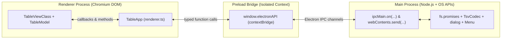
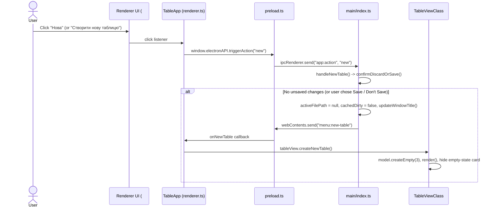
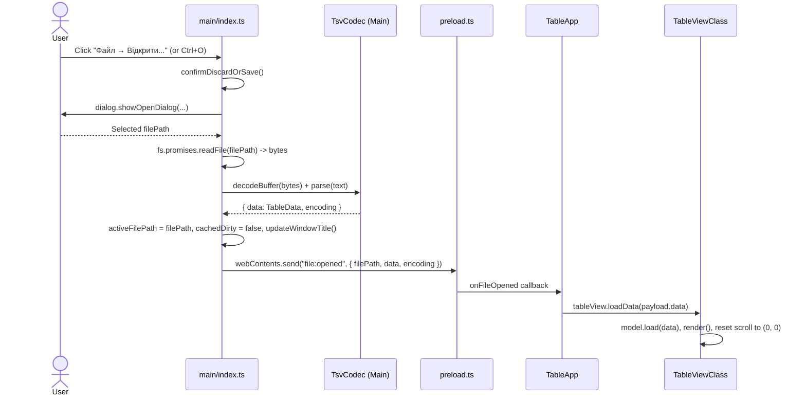
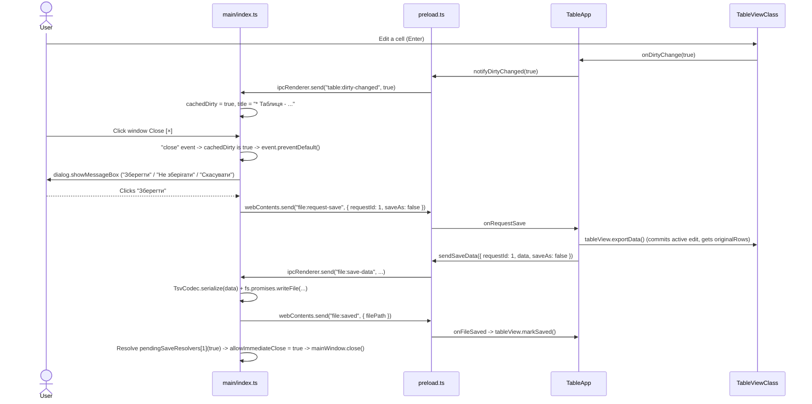

# How IPC Works in `calc_work_oop`

Electron splits a desktop application into separate OS processes. **IPC (Inter-Process Communication)** is the message-passing layer that lets the UI communicate safely with native OS features (files, menus, dialogs) without exposing Node.js directly to browser code.

---

## 1. The 3-Layer Security Boundary

In [src/main/index.ts](file:///home/prisyaga/uni/oop/calc_work_oop/src/main/index.ts#L301-L305), the window is created with:

```ts
webPreferences: {
  preload: PRELOAD_PATH,
  contextIsolation: true,
  nodeIntegration: false,
}
```

Because `nodeIntegration` is `false` and `contextIsolation` is `true`:

1. **Main Process** ([src/main/index.ts](file:///home/prisyaga/uni/oop/calc_work_oop/src/main/index.ts))
   - Runs in full Node.js + Electron environment.
   - Has access to `fs.promises`, `dialog`, `Menu`, and `BrowserWindow`.
   - Cannot touch the HTML DOM directly.
2. **Renderer Process** ([src/renderer/renderer.ts](file:///home/prisyaga/uni/oop/calc_work_oop/src/renderer/renderer.ts), [table_view.ts](file:///home/prisyaga/uni/oop/calc_work_oop/src/renderer/table_view.ts), [table_model.ts](file:///home/prisyaga/uni/oop/calc_work_oop/src/renderer/table_model.ts))
   - Runs in Chromium like a normal web page.
   - Owns the DOM, `TableViewClass`, and `TableModel`.
   - Has **no** access to `fs`, `require`, `process`, or raw `ipcRenderer`.
3. **Preload Script** ([src/preload/preload.ts](file:///home/prisyaga/uni/oop/calc_work_oop/src/preload/preload.ts))
   - Runs in an isolated bridge context before `index.html` scripts execute.
   - Uses Electron's `contextBridge.exposeInMainWorld('electronAPI', api)` to expose **only** the approved wrapper functions defined by `ElectronAPI` in [src/shared/table_types.ts](file:///home/prisyaga/uni/oop/calc_work_oop/src/shared/table_types.ts#L62-L74).
   - Never leaks raw `ipcRenderer` to the Renderer, so page code cannot invent arbitrary channels.



Notice that **`TableViewClass` and `TableModel` do not import Electron at all**. Only `TableApp` ([src/renderer/renderer.ts](file:///home/prisyaga/uni/oop/calc_work_oop/src/renderer/renderer.ts)) talks to `window.electronAPI`, keeping the OOP table classes completely decoupled from the desktop shell.

---

## 2. Complete IPC Channel Reference

All channels use asynchronous message passing (`ipcRenderer.send` / `webContents.send` $\leftrightarrow$ `ipcMain.on` / `ipcRenderer.on`):

| Channel               | Direction                   | Preload Method          | Payload Type                                         | Purpose                                                                       |
| --------------------- | --------------------------- | ----------------------- | ---------------------------------------------------- | ----------------------------------------------------------------------------- |
| `file:opened`         | Main $\rightarrow$ Renderer | `onFileOpened(cb)`      | `OpenedFilePayload` (`filePath`, `data`, `encoding`) | Send parsed TSV table from disk into `TableViewClass`                         |
| `menu:new-table`      | Main $\rightarrow$ Renderer | `onNewTable(cb)`        | _(none)_                                             | Initialize a blank 3-column table                                             |
| `menu:add-row`        | Main $\rightarrow$ Renderer | `onAddRow(cb)`          | _(none)_                                             | Trigger `tableView.addEmptyRow()` from native menu / shortcut                 |
| `menu:delete-row`     | Main $\rightarrow$ Renderer | `onDeleteRow(cb)`       | _(none)_                                             | Trigger `tableView.deleteSelectedRow()` from native menu / shortcut           |
| `menu:add-column`     | Main $\rightarrow$ Renderer | `onAddColumn(cb)`       | _(none)_                                             | Trigger `tableView.addColumn()` from native menu                              |
| `file:request-save`   | Main $\rightarrow$ Renderer | `onRequestSave(cb)`     | `SaveRequestPayload` (`requestId`, `saveAs`)         | Ask Renderer to export current `TableData` for saving                         |
| `file:save-data`      | Renderer $\rightarrow$ Main | `sendSaveData(payload)` | `SaveDataPayload` (`requestId`, `data`, `saveAs`)    | Return canonical `TableData` to Main for disk write                           |
| `file:save-canceled`  | Renderer $\rightarrow$ Main | `cancelSaveRequest(id)` | `number` (`requestId`)                               | Notify Main if no table is open so the save promise resolves `false`          |
| `file:saved`          | Main $\rightarrow$ Renderer | `onFileSaved(cb)`       | `SavedFilePayload` (`filePath`)                      | Tell Renderer the write succeeded so `tableView.markSaved()` clears `isDirty` |
| `table:dirty-changed` | Renderer $\rightarrow$ Main | `notifyDirtyChanged(b)` | `boolean`                                            | Keep Main's `cachedDirty` synchronized for title `*` & close guard            |
| `app:action`          | Renderer $\rightarrow$ Main | `triggerAction(action)` | `'new' \| 'open' \| 'save' \| 'save-as'`             | Let HTML toolbar / empty-state buttons trigger Main file workflows            |

---

## 3. The Three IPC Patterns Used

### Pattern A: One-Way Command Push (Main $\rightarrow$ Renderer)

Used when the user clicks a **native OS menu item** (or presses a menu shortcut like `Ctrl+Enter`). Main emits an event to `mainWindow.webContents.send(...)`, and `TableApp` reacts in `bindIpcEvents()`.

Example (`Таблиця → Додати рядок`):

1. User clicks menu item in [src/main/index.ts](file:///home/prisyaga/uni/oop/calc_work_oop/src/main/index.ts#L243-L248) $\rightarrow$ `mainWindow?.webContents.send('menu:add-row')`.
2. Preload forwards the event to the callback registered via `window.electronAPI.onAddRow(...)`.
3. `TableApp` calls `this.tableView.addEmptyRow()`.

### Pattern B: Action Trigger & Eager State Sync (Renderer $\rightarrow$ Main)

1. **Toolbar/Empty-State Actions (`app:action`):**
   - HTML buttons inside the window (such as `#btn-new`, `#btn-open`, `#btn-save`, or `"Створити нову таблицю"`) live in the Renderer, so they cannot open `dialog.showOpenDialog` themselves.
   - Clicking them calls `window.electronAPI?.triggerAction('new' | 'open' | 'save')`.
   - Main receives `'app:action'` ([src/main/index.ts](file:///home/prisyaga/uni/oop/calc_work_oop/src/main/index.ts#L386-L402)) and runs the exact same handler (`handleNewTable`, `handleOpenFile`, `requestSaveFromRenderer`) as the native menu.

2. **Eager Dirty-State Sync (`table:dirty-changed`):**
   - Whenever `TableModel.dirty` flips between `false` and `true`, `TableViewClass.emitStateChanges()` fires `onDirtyChange(isDirty)`.
   - `TableApp` sends `window.electronAPI?.notifyDirtyChanged(isDirty)`.
   - Main updates `cachedDirty` and refreshes the window title (`* Таблиця - ...`).
   - **Why push eagerly instead of asking on close?** Electron's `mainWindow.on('close', event => ...)` event is **synchronous**: `event.preventDefault()` must be called synchronously in that tick. Having `cachedDirty` already cached in Main lets Main decide immediately whether to close right away or cancel the close and show the _"Save changes?"_ confirmation dialog.

### Pattern C: Correlated Request / Response (`requestId` Pattern for Saving)

Notice that saving can be initiated in two places:

- Directly via `Файл → Записати` (`Ctrl+S`) or `Записати як...` (`Ctrl+Shift+S`)
- Indirectly via the **unsaved-changes guard** (`confirmDiscardOrSave()`), which must **await** whether the user actually finished saving before proceeding to open another file, create a new table, or close the window.

To let Main `await` an asynchronous save roundtrip with the Renderer cleanly, Main uses a **correlation ID (`requestId`)** and a `Map` of promise resolvers ([src/main/index.ts](file:///home/prisyaga/uni/oop/calc_work_oop/src/main/index.ts#L24-L25) and [L95-L107](file:///home/prisyaga/uni/oop/calc_work_oop/src/main/index.ts#L95-L107)):

1. Main increments `nextSaveRequestId`, stores `resolve` in `pendingSaveResolvers.set(requestId, resolve)`, and sends `'file:request-save'` with `{ requestId, saveAs }`.
2. Renderer commits any active inline cell edit via `tableView.exportData()` and replies on `'file:save-data'` with `{ requestId, data, saveAs }` (or `'file:save-canceled'` if there is no table).
3. Main writes the file via `writeTableToFile(data, saveAs)`, sends `'file:saved'` back to Renderer if successful, then looks up `pendingSaveResolvers.get(requestId)` and resolves the `Promise<boolean>` (`true` if saved, `false` if canceled or write failed).
4. If the window closes mid-flight, the `'closed'` handler resolves any leftover pending resolvers with `false` so no Promise hangs forever.

---

## 4. End-to-End Sequence Traces

### Flow 1: Creating a New Table (Toolbar Button or Menu)



_(If the user presses `Ctrl+N` or clicks `Файл → Нова таблиця` in the native menu, Main skips the first 3 steps and enters `handleNewTable()` directly.)_

### Flow 2: Opening a TSV File (`Файл → Відкрити...`)



### Flow 3: Closing the Window with Unsaved Changes (`isDirty === true`)



---

## 5. Main-Process Payload Validation

Even though the Renderer only runs our bundled local `index.html`, Main treats every incoming IPC payload as `unknown` and validates it at runtime ([src/main/index.ts](file:///home/prisyaga/uni/oop/calc_work_oop/src/main/index.ts#L36-L50) and [L344-L402](file:///home/prisyaga/uni/oop/calc_work_oop/src/main/index.ts#L344-L402)):

- `file:save-data`: checks `typeof candidate.requestId === 'number'` and verifies `isValidTableData(candidate.data)` (`headers` is `string[]` and `rows` is `string[][]`) before touching `TsvCodec` or the filesystem.
- `file:save-canceled`: verifies `typeof requestId === 'number'`.
- `table:dirty-changed`: verifies `typeof isDirty === 'boolean'`.
- `app:action`: switches only on the 4 expected string literals (`'new'`, `'open'`, `'save'`, `'save-as'`).

---

## 6. Why This Design Uses `send` / `on` (and When `invoke` / `handle` Differs)

Electron offers two IPC styles:

1. **Event-driven `send` / `on`** _(used here)_:
   - Natural when communication is initiated from **both sides** (e.g., native menu clicks originate in Main, while toolbar clicks originate in Renderer).
   - Mirrors the IPC pattern in `../graphical-editor`.
2. **RPC-style `ipcRenderer.invoke` / `ipcMain.handle`**:
   - Useful when Renderer calls Main like an async function and awaits a return value (e.g., `const data = await window.electronAPI.openFile()`).
   - Less natural when Main initiates the action (such as a native `Menu` item or `BrowserWindow` `'close'` event asking Renderer for its state).

By combining `send`/`on` with the `requestId` resolver map for saving, both Menu-initiated and Toolbar-initiated flows share the exact same Main handlers without duplicating logic.
